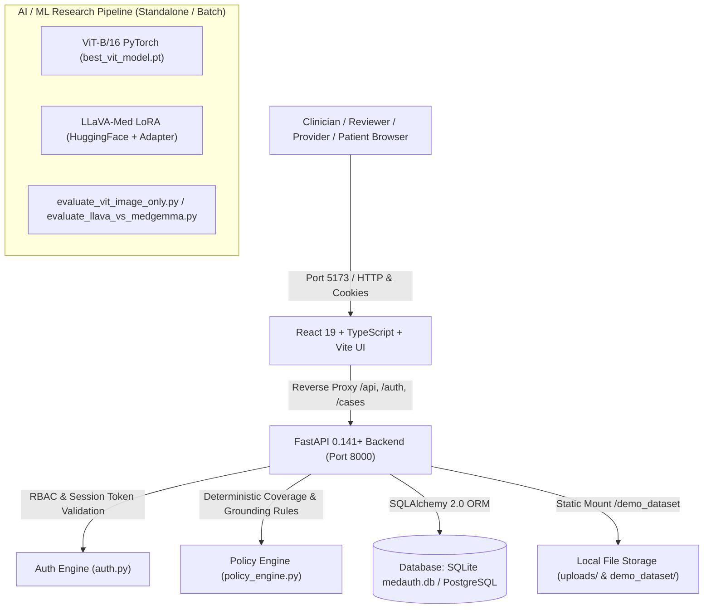

# PROJECT ANALYSIS: ANVESH (MedAuth-VLM)

## 1. Executive Summary & Project Overview

**ANVESH (MedAuth-VLM)** is an enterprise clinical and AI benchmark system designed for **Prior Authorization Automation and Radiographic Grounding Verification**. It pairs Vision-Language Models (VLMs) and Vision Transformers (ViTs) with clinical rules engines to evaluate prior authorization requests for radiographic procedures (e.g., Chest X-rays) against insurance coverage policies (CMS / Commercial).

The platform bridges clinical evidence extracted from DICOM/PNG radiographs and clinical indications against structured insurance policy guidelines, preventing unauthorized denials or fraudulent approvals while maintaining a complete audit trail.

---

## 2. Repository Folder Structure

```
ANVESH/
├── alembic/                         # Database schema migrations
├── alembic.ini                      # Alembic configuration
├── anvesh_dataset/                  # Multimodal train/val/test splits (LLaVA-Med)
│   ├── train.json
│   ├── val.json
│   └── test.json
├── anvesh_dataset_image_only/       # Image-only baseline splits (ViT & LLaVA)
│   ├── train.json
│   ├── val.json
│   └── test.json
├── backups/                         # Pre-import database SQL dump & evaluation backups
│   ├── medauth_vlm_pre_import_20261011_174043.sql   # Canonical database benchmark dump
│   └── *.json, *.csv
├── checkpoints_llava/               # Multimodal LLaVA LoRA adapter weights (169 MB)
├── checkpoints_llava_image_only/    # Image-only LLaVA LoRA adapter weights (169 MB)
├── checkpoints_vit_image_only/      # ViT-B/16 PyTorch model checkpoint (343 MB)
│   ├── best_vit_model.pt
│   ├── vit_config.json
│   └── vit_training_history.csv
├── demo_dataset/                    # Curated sample clinical cases with radiographs
│   ├── cases/
│   └── manifest.json
├── frontend/                        # Vite + React 19 + TypeScript clinical workstation
│   ├── src/
│   │   ├── components/              # UI components (Viewer, Navigation, Decision modals)
│   │   ├── context/                 # AuthContext & Session management
│   │   ├── pages/                   # Portal views (Reviewer, Provider, Patient, Admin)
│   │   └── services/                # API client layer (Fetch client with cookie auth)
│   ├── tests/                       # Automated frontend suite (node --test)
│   ├── package.json
│   └── vite.config.ts
├── reports/                         # Benchmark evaluation reports and charts
├── tests/                           # Pytest comprehensive test suite (53 tests)
│   ├── test_auth_rbac.py
│   ├── test_benchmark_integrity.py
│   ├── test_final_artifacts.py
│   ├── test_image_only_artifacts.py
│   ├── test_image_only_diagnosis.py
│   ├── test_submissions_uploads.py
│   └── test_vit_artifacts.py
├── uploads/                         # Directory for submitted clinical documents & radiographs
├── auth.py                          # Session-based cookie auth, RBAC, Rate-limiting, Bcrypt
├── database.py                      # SQLAlchemy engine with SQLite/Postgres auto-switching
├── init_sqlite_db.py                # Standalone DB populator from canonical SQL dump
├── main.py                          # FastAPI application (1,486 lines, full REST API)
├── models.py                        # SQLAlchemy ORM models (Case, Evidence, Policy, User, etc.)
├── policy_engine.py                 # Deterministic clinical prior authorization policy engine
├── schemas.py                       # Pydantic v2 validation and response schemas
├── storage.py                       # File storage, MIME verification, magic bytes validation
└── evaluate_*.py, train_*.py        # Model evaluation & training pipelines
```

---

## 3. Architecture & Technology Stack



### 3.1 Technology Stack Details
- **Frontend:** React 19, TypeScript 6.0, Vite 8.3, Lucide React icons, Native CSS tokens & GSAP animations.
- **Backend:** Python 3.11/3.13, FastAPI 0.141, Starlette, Uvicorn, Pydantic v2.
- **Database / ORM:** SQLAlchemy 2.0 with cross-engine dialect compatibility (JSONB mapped to SQLite JSON). Supports SQLite (`sqlite:///./medauth.db`) and PostgreSQL 18.
- **Security / Auth:** HTTP-only secure cookie sessions with 64-character cryptographic tokens, Bcrypt password hashing (`bcrypt 5.0.0`), in-memory IP sliding-window rate limiting, and Role-Based Access Control (RBAC).
- **AI & Deep Learning:** PyTorch 2.11, TorchVision 0.26, Transformers 5.4, PEFT (LoRA), torchvision ViT-B/16 classifier, LLaVA 1.5/Med 4-bit / bfloat16 models.

---

## 4. Backend & Frontend Workflows

1. **Authentication:** 
   - User inputs credentials on `/` login modal.
   - Frontend calls `POST /auth/login`. Backend verifies bcrypt hash, writes a `UserSession` entry into DB, and returns a secure session cookie + user role profile.
2. **Clinical Reviewer Portal (`insurance_reviewer` / `insurance_admin`):**
   - Accesses `/api/cases` (or paginated `/cases`).
   - Retrieves case details and associated DICOM/PNG images.
   - Requests `GET /cases/{case_id}/review?plan_id={plan_id}&persist=false` to calculate real-time deterministic coverage compliance, evidence consistency score, and clinical recommendations.
   - Submits human decision via `POST /reviews/{review_id}/decision` or `POST /submissions/{id}/decision`.
3. **Provider Portal (`provider`):**
   - Submits prior authorization requests with clinical notes (`POST /api/submissions`).
   - Uploads radiographic evidence (`POST /api/submissions/{id}/upload`). Magic bytes (`89 50 4E 47` for PNG, `%PDF` for PDF) and MIME types are strictly verified.
4. **Patient Portal (`patient`):**
   - Allows self-registration (`POST /auth/register`).
   - Restricts view strictly to their personal submissions (`GET /api/submissions/my`).

---

## 5. Database Schema & Relationships

- **`cases`:** Core radiographic benchmark table. Contains `case_id`, `classification` ("normal"/"abnormal"), `indication`, `findings`, `impression`, `requested_procedure`, `has_source_text`.
- **`case_images`:** Foreign key to `cases.case_id`. Holds `filename`, `projection` (Frontal/Lateral), `file_path`.
- **`evidence`:** One-to-one with `cases.case_id`. Stores structured model inferences: `image_evidence`, `text_image_consistency`, `clinical_support`, `raw_model_output`.
- **`policies`:** Insurance policy guidelines indexed by `plan_id`, `state`, `is_covered`, `copay`, `coinsurance`, `exclusions`.
- **`reviews`:** Links `cases` to `policies`. Records `policy_compliance`, `evidence_score`, `recommendation`, `reviewer_decision`, `reviewer_notes`.
- **`users`:** User accounts with `email`, `hashed_password`, `role`, `organization`, `is_active`.
- **`user_sessions`:** Active tokens for cookie-based RBAC with expiration and revocation flags.
- **`submissions` & `submission_files`:** Live prior-authorization filing queue for providers, patients, and insurers.

---

## 6. API Endpoints Reference

| Method | Endpoint | Access Role | Description |
|---|---|---|---|
| `GET` | `/health` | Public | Database connection ping & service health |
| `GET` | `/api/summary` | Public | Aggregate database metrics and batch statistics |
| `POST` | `/auth/login` | Public | Authenticate user and issue session cookie |
| `POST` | `/auth/logout` | Authenticated | Revoke session and clear cookies |
| `GET` | `/auth/me` | Authenticated | Current authenticated user profile |
| `POST` | `/auth/register` | Public | Self-registration for patient role |
| `GET` | `/api/cases` | Reviewer, Admin | Paginated list of clinical cases |
| `GET` | `/api/cases/{case_id}` | Reviewer, Admin | Single case details with images and evidence |
| `GET` | `/cases/{case_id}/review` | Reviewer, Admin | Execute deterministic policy evaluation |
| `POST` | `/reviews/{id}/decision` | Reviewer, Admin | Record final clinical authorization verdict |
| `GET` | `/api/submissions` | Provider, Reviewer, Admin | Submissions queue (filtered by organization/role) |
| `POST` | `/api/submissions` | Provider | Create new prior authorization submission |
| `POST` | `/api/submissions/{id}/upload` | Provider | Upload validated PDF or PNG evidence |

---

## 7. AI Models & Execution Status

1. **Vision Transformer (ViT-B/16):**
   - **File:** `checkpoints_vit_image_only/best_vit_model.pt` (343 MB).
   - **Task:** Binary classification (`normal` vs `abnormal`) directly from radiographic images without prompt leakage.
   - **Execution:** Fully verified to load and execute inference on **both CPU and CUDA**.
2. **LLaVA-Med Multimodal VLM:**
   - **Files:** `checkpoints_llava/final_adapter/` & `checkpoints_llava_image_only/final_adapter/` (169 MB LoRA adapters).
   - **Task:** Generates dense clinical evidence, text-image consistency scores, and impression justification.
   - **Execution:** Offline pre-computed evidence for all 950 benchmark cases is stored in the `evidence` table, allowing the API and workstation to run at low latency without requiring an active 24GB VRAM GPU. Evaluation/fine-tuning scripts require HuggingFace base weights and GPU acceleration for full training loops.

---

## 8. Verified Test Results

- **Backend Pytest Suite:** **53 of 53 tests passed** (100% pass rate).
  - RBAC & Password Hashing: PASSED
  - Metric Formulas & Wilson Confidence Intervals: PASSED
  - Submissions & Magic-Byte Upload Security: PASSED
  - Artifact & ViT Integrity: PASSED
- **Frontend Automated Suite:** **10 of 10 tests passed** (100% pass rate).
  - Design tokens, motion easing, session isolation, and decision safety: PASSED
- **Frontend Production Build:** `tsc -b && vite build` built clean in 1.06s.
- **Database Initialization:** 950 cases, 1,839 images, 950 evidence items, 100 policies, and 5 demo accounts populated in `medauth.db`.
- **Live Server Connectivity:** Both FastAPI on `http://127.0.0.1:8000` and Vite on `http://127.0.0.1:5173` running and responding.
