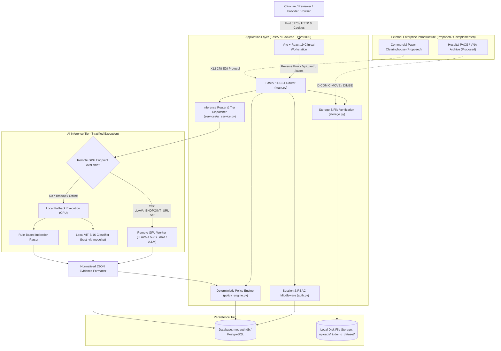
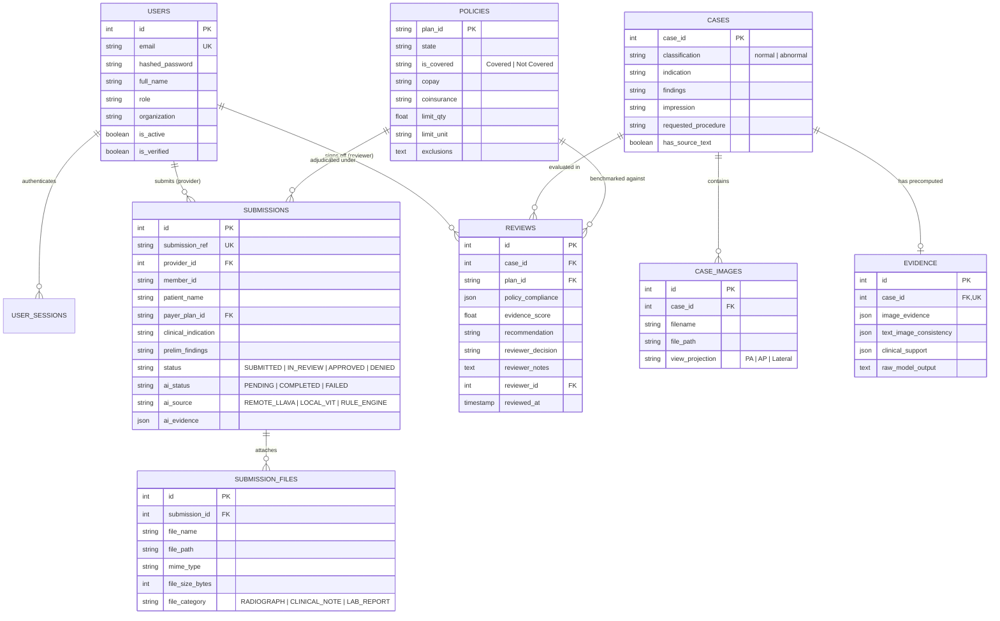
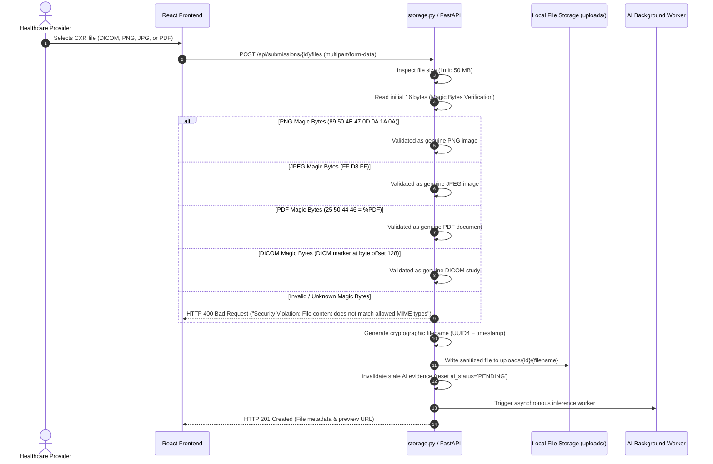
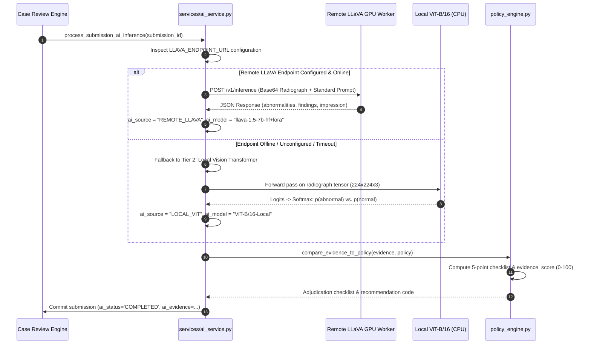

# ANVESH: Automated Prior-Authorization Verification & Radiographic Grounding Engine
## Technical Documentation — Document 2: System Architecture

---

### 1. Overall System Architecture Overview

ANVESH is designed around a three-tier, decoupled client-server architecture paired with an asynchronous artificial intelligence inference worker. It strictly separates the human presentation layer (React 19), the application and business logic layer (FastAPI), the persistence layer (SQLAlchemy ORM + SQLite/PostgreSQL), and the deep learning execution pipeline (PyTorch + HuggingFace Transformers).



---

### 2. Frontend Architecture (React 19 + TypeScript + Vite)

The frontend workstation is built using React 19, TypeScript 6.0, and Vite 8.3, providing immediate rendering without heavy client-side compilation delays.

```
frontend/src/
├── components/                  # Reusable clinical interface primitives
│   ├── common/
│   │   ├── DecisionModal.tsx    # Human authorization sign-off modal
│   │   ├── MedicalImageViewer.tsx # Greyscale native CXR raster viewer
│   │   ├── Navigation.tsx       # Role-aware global navigation bar
│   │   └── Preloader.tsx        # High-performance initial load coordinator
│   └── portal/                  # Portal-specific cards, steppers, and filters
├── context/
│   └── AuthContext.tsx          # React Context holding current session user, role, and preview mode
├── pages/
│   ├── AboutPage.tsx            # Architectural documentation & academic overview
│   ├── HowItWorksPage.tsx       # Visual interactive pipeline explainer
│   ├── HowToUsePage.tsx         # Operating handbook and troubleshooting guide
│   ├── LandingPage.tsx          # System welcome & role portal launcher
│   └── portal/
│       ├── insurance/           # Reviewer & Admin adjudication workspace
│       ├── patient/             # Patient submission & policy tracking
│       └── provider/            # Hospital intake & radiograph upload wizard
├── services/
│   ├── api.ts                   # Fetch API wrapper with cookie credentials and error interceptors
│   └── demoFixtures.ts          # Isolated synthetic fixture generator for development preview
└── styles/
    ├── tokens.css               # Clinical design tokens (HSL variables, font families)
    ├── global.css               # Base typographic and layout reset
    ├── App.css                  # Frame styling and desktop container constraints
    └── clinical_utilities.css   # 1,934-line zero-dependency atomic utility engine
```

#### Key Frontend Architectural Principles:
1. **Zero-Layout Shift (CLS = 0):** All interactive elements (tabs, tables, buttons) feature fixed padding, reserved 1.5px borders, and hardware-accelerated transforms (`translateZ(0)`) in `clinical_utilities.css` to eliminate visual jitter during diagnostic reading.
2. **Medical Image Fidelity:** The `MedicalImageViewer` component displays 8-bit and 16-bit radiograph rasters strictly in their native grayscale color space, forbidding artificial heatmaps or misleading synthetic colormaps that could distort subtle lung pathology.
3. **Role-Based Routing Isolation:** Navigation links and portal workspaces are dynamically filtered based on the active session role (`insurance_admin`, `insurance_reviewer`, `provider`, `patient`).

---

### 3. Backend Architecture (FastAPI + Starlette)

The backend is engineered as a high-throughput, asynchronous REST service implemented in Python 3.11 using FastAPI 0.141 and Starlette:

- **Entry Point:** `main.py` (1,563 lines) implements 60 registered REST routes.
- **Middleware Pipeline:**
  1. **CORS Middleware:** Configured with `allow_origins=["http://localhost:5173", "http://127.0.0.1:5173"]`, `allow_credentials=True`, supporting cross-origin cookies.
  2. **Audit Logging Middleware:** Intercepts every incoming HTTP request, logs the start timestamp, IP address, client user-agent, route method/path, and measures sub-millisecond execution duration upon response emission.
  3. **Rate Limiting:** In-memory sliding-window limiter (`auth.py`) enforcing a maximum of 10 login requests per minute per IP to prevent brute-force attacks.

---

### 4. Authentication & Authorization Workflow (RBAC)

ANVESH enforces strict Role-Based Access Control (RBAC) with HTTP-only cookie sessions:

```mermaid
sequenceDiagram
    autonumber
    actor Clinician as User / Clinician
    participant Browser as Browser Client
    participant Auth as FastAPI /auth/login
    participant DB as Database (User / UserSession)
    
    Clinician->>Browser: Enters email and password
    Browser->>Auth: POST /auth/login (JSON payload)
    Auth->>DB: Query User by email
    DB-->>Auth: User record (bcrypt hash, role, active status)
    Auth->>Auth: Verify bcrypt hash (bcrypt.checkpw)
    
    alt Invalid Credentials
        Auth-->>Browser: HTTP 401 Unauthorized ("Invalid email or password")
    else Valid Credentials
        Auth->>Auth: Generate 64-char crypto token (secrets.token_urlsafe(48))
        Auth->>DB: Insert UserSession (token, user_id, expires_at +24h)
        Auth-->>Browser: HTTP 200 OK + Set-Cookie: medauth_session=TOKEN; HttpOnly; SameSite=Lax
        Browser-->>Clinician: Redirects to role-appropriate portal dashboard
    end
```

#### Roles & Permissions:
- `insurance_admin`: Full database access, user management (`/api/auth/register`), analytics inspection, and reviewer assignment.
- `insurance_reviewer`: Access to the case review queue (`/api/cases`), detailed case inspection, deterministic policy execution, and final decision recording (`/api/reviews/{id}/decision`).
- `provider`: Submission creation (`/api/submissions`), radiograph file upload (`/api/submissions/{id}/files`), and provider-specific submission tracking (`/api/submissions/mine`).
- `patient`: Restricted view limited to personal submissions (`patient_user_id == current_user.id`) and policy deductible lookup.

---

### 5. Database Architecture & Schema Relationships

The persistence layer supports both SQLite (`sqlite:///./medauth.db`) and PostgreSQL 18. Cross-database compatibility is achieved by compiling PostgreSQL `JSONB` columns to standard SQLite `TEXT` / `JSON` types during SQLite execution.



---

### 6. Image Upload & Magic-Byte Validation Workflow

Security in medical imaging systems requires strict file intake validation to prevent arbitrary code execution or polyglot payload injection:



---

### 7. Model Inference & Evidence Generation Workflow

When a radiograph is uploaded or an adjudication workspace is opened, the system dispatches inference through a multi-tier hierarchy:



---

### 8. Error Handling & Resilience Architecture

1. **Stale Evidence Invalidation:** Attaching a new radiograph immediately resets `ai_evidence = None` and forces re-evaluation. A reviewer is never shown determinations derived from a replaced radiograph.
2. **Deterministic Fallback Transparency:** If the remote 7B VLM is unreachable, the system records `ai_source = "LOCAL_VIT"` or `ai_source = "RULE_ENGINE"`, logging the exact exception in `ai_error`. The system never fabricates or pretends that an offline neural model generated the evidence.
3. **Database Transaction Rollback:** All review and decision mutations execute inside SQLAlchemy context managers (`db.begin_nested()`). If a database commit fails, the transaction is cleanly rolled back, returning HTTP 500 without corrupting case state.
4. **Missing Ground-Truth Safeguard:** If an incoming case lacks clinical report text (`has_source_text = False`), the policy engine caps the maximum possible evidence score at $\le 40/100$ and sets `recommendation = "MANUAL_REVIEW_REQUIRED"`, mathematically preventing automated approval on unverified image predictions.
