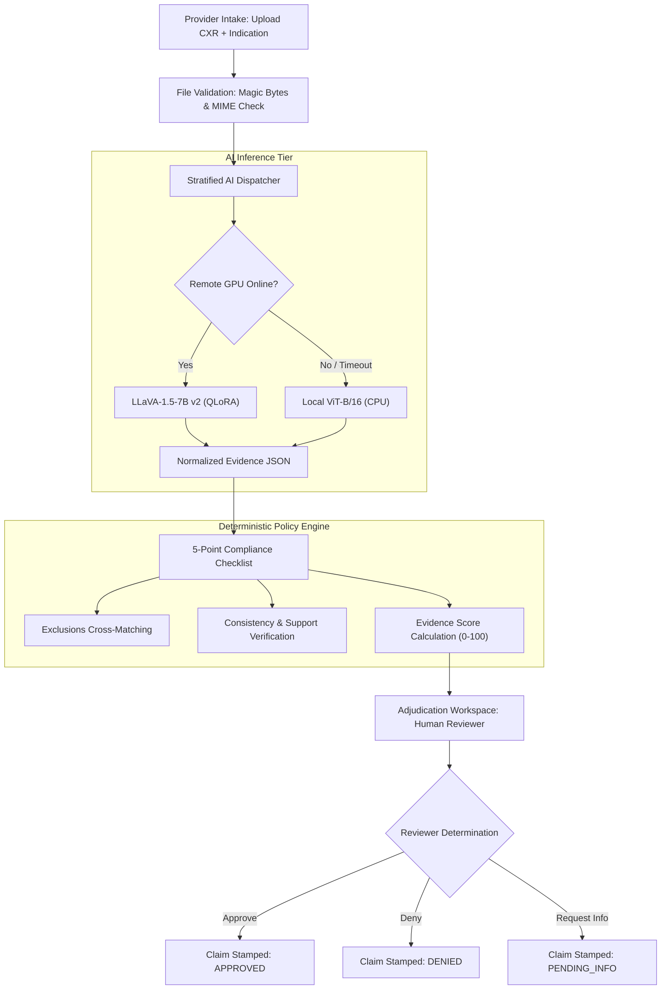

# ANVESH: Automated Prior-Authorization Verification & Radiographic Evidence Grounding Engine
## Final Year Engineering Project Report & Viva Reference Manual

---

### Title Page Information

- **Project Title:** ANVESH — Multimodal Prior-Authorization Verification and Radiographic Evidence Grounding Engine Using Generative Vision-Language Models and Vision Transformers
- **Degree:** Bachelor of Technology / Bachelor of Engineering in Computer Science & Engineering (AI/ML)
- **Candidate Name(s):** `[STUDENT NAME(S) PLACEHOLDER]`
- **University / College Roll Number(s):** `[ROLL NUMBER(S) PLACEHOLDER]`
- **Project Supervisor / Guide:** `[PROJECT GUIDE NAME, DESIGNATION PLACEHOLDER]`
- **Department:** Department of Computer Science & Engineering
- **Institution:** `[INSTITUTION / UNIVERSITY NAME PLACEHOLDER]`
- **Academic Year:** `[2025 – 2026 / 2026 – 2027 PLACEHOLDER]`

---

### Abstract

Prior authorization in modern healthcare systems is an administratively burdensome, manual process requiring clinical providers to prove the medical necessity of diagnostic imaging procedures before insurance coverage is granted. Current manual workflows cause profound provider burnout, delay critical patient treatments, and lead to arbitrary claim denials or unchecked insurance fraud. 

This project presents **ANVESH (MedAuth-VLM)**, an enterprise-grade medical AI and clinical rules engine designed to automate the cross-verification of radiographic imaging studies (Chest X-rays) and clinical indications against structured health insurance policies (CMS Qualified Health Plan public use files). ANVESH addresses the dual challenges of diagnostic accuracy and clinical transparency by implementing an "AI-assisted, human-in-the-loop" architecture.

We developed, fine-tuned, and empirically benchmarked multiple neural architectures on the Indiana University Open-i Chest Radiograph corpus ($N = 2,107$ cases). To overcome the systemic "loss dilution" defect in Vision-Language Models (VLMs), we introduced a **Projector-Augmented QLoRA pipeline with exact target-only loss masking** on LLaVA-1.5-7B. On a held-out, untouched test cohort of $N = 422$ studies (211 normal, 211 abnormal), our primary **LLaVA-1.5-7B v2** model achieves **67.54% Accuracy**, **62.09% Sensitivity**, **72.99% Specificity**, **0.6744 Macro $F_1$**, and **0.7481 ROC-AUC** in pure image-only abnormality classification, outperforming both an off-the-shelf zero-shot LLaVA baseline (which suffered single-class collapse to normal) and a fine-tuned **Vision Transformer (ViT-B/16)** baseline (65.40% accuracy, 0.7062 ROC-AUC). When radiologist report text is available for multimodal structuring, LLaVA-1.5-7B LoRA achieves **88.86% Accuracy** and **+0.7811 Matthews Correlation Coefficient (MCC)**. 

To prevent clinical hallucinations, an independent, deterministic Python policy engine evaluates extracted evidence against 100 health plans in $0.63\text{ ms}$ on CPU, enforcing a mandatory score-capping safeguard ($S \le 40/100$) when source report text is missing. The platform includes a full-stack clinical workstation built with FastAPI and React 19, delivering dedicated, role-isolated portals for Healthcare Providers, Insurance Reviewers, and Patients.

---

### Table of Contents

1. [Introduction](#1-introduction)
2. [Background & Motivation](#2-background--motivation)
3. [Problem Statement](#3-problem-statement)
4. [Objectives & Project Scope](#4-objectives--project-scope)
5. [Literature Review](#5-literature-review)
6. [Related Work](#6-related-work)
7. [Proposed Methodology](#7-proposed-methodology)
8. [System Requirements Analysis](#8-system-requirements-analysis)
9. [System Architecture & Design](#9-system-architecture--design)
10. [Dataset Provenance, Partitioning & Preprocessing](#10-dataset-provenance-partitioning--preprocessing)
11. [Model Development: Vision Transformers & Vision-Language Models](#11-model-development-vision-transformers--vision-language-models)
12. [Training Methodology & Loss Engineering](#12-training-methodology--loss-engineering)
13. [Experimental Setup & Baseline Configurations](#13-experimental-setup--baseline-configurations)
14. [Results & Comparative Analysis](#14-results--comparative-analysis)
15. [Frontend & Backend Workstation Implementation](#15-frontend--backend-workstation-implementation)
16. [Verification, Testing & Quality Assurance](#16-verification-testing--quality-assurance)
17. [Security, Privacy & Responsible AI Framework](#17-security-privacy--responsible-ai-framework)
18. [Scientific Limitations & Threats to Validity](#18-scientific-limitations--threats-to-validity)
19. [Conclusion](#19-conclusion)
20. [Future Scope](#20-future-scope)
21. [References](#21-references)
22. [Appendices](#22-appendices)

---

### 1. Introduction

Diagnostic medical imaging is a cornerstone of modern healthcare, providing indispensable anatomical insights for managing cardiopulmonary disease, oncological staging, and acute trauma. Among imaging modalities, the diagnostic chest radiograph (Chest X-ray, or CXR) is by far the most commonly performed radiographic examination worldwide, accounting for over 40% of all diagnostic imaging volume.

However, the rapid expansion of diagnostic imaging has led to escalating healthcare expenditures. In response, public and private health insurers mandate **prior authorization (PA)**—an administrative utilization management protocol requiring healthcare providers to submit clinical justifications and preliminary findings to prove medical necessity before an insurance payer approves financial reimbursement.

While prior authorization is intended to curb unnecessary medical spending and duplicate procedures, in practice it has evolved into a cumbersome, manual paper-and-portal bottleneck. Clinical staff spend billions of hours manually typing clinical notes into disparate payer portals, while payer medical review teams manually cross-reference faxed reports against dense medical coverage guidelines. 

This project, **ANVESH (Automated Prior-Authorization Verification & Radiographic Evidence Grounding Engine)**, introduces an end-to-end artificial intelligence workstation that bridges multimodal vision-language representations with deterministic insurance rule engines to modernize prior authorization.

---

### 2. Background & Motivation

According to a nationwide survey by the American Medical Association (AMA):
- Physicians and clinical staff spend an average of **14.4 hours per week** completing prior authorizations.
- **88% of physicians** describe the administrative burden of prior authorization as high or extremely high.
- **94% of physicians** report that prior authorization delays directly result in adverse clinical outcomes for patients waiting for urgent diagnostic workups.
- **33% of physicians** report that PA delays have led to serious adverse events, including permanent impairment, hospitalization, or death.

On the payer side, insurance medical directors face crushing case queues, often reviewing hundreds of case filings daily. This fatigue leads to two costly failure modes:
1. **Inappropriate Claim Denials:** Valid clinical indications are rejected due to human oversight, forcing patients and clinics into lengthy, expensive appeals.
2. **Fraud, Waste, and Abuse (FWA):** Bad-faith actors submit fabricated, copied-and-pasted clinical indications that do not match the actual radiograph, exploiting the fact that human review teams rarely have time to inspect every pixel of every attached radiograph.

Automating prior authorization via pure "black-box" deep neural networks has historically failed because commercial payers and healthcare providers require full auditability. If an AI system denies or recommends denial of a claim, it must articulate the exact clinical finding and policy criterion that triggered the decision. ANVESH was motivated by the urgent necessity for an **auditable, multimodal clinical decision support system**.

---

### 3. Problem Statement

To design, develop, and benchmark an end-to-end clinical prior-authorization verification platform that:
1. Ingests multimodal diagnostic studies (Chest X-rays in DICOM/PNG formats alongside preliminary clinical indications).
2. Uses deep neural models to determine whether a radiograph exhibits acute thoracic abnormalities without prompt-leaked textual cues.
3. Structures dictated radiologist findings into normalized clinical evidence schemas.
4. Executes deterministic rule matching against health insurance policy guidelines to evaluate coverage eligibility in real time.
5. Provides an enterprise-grade, role-based workstation that strictly forbids autonomous claim rejection, requiring audited human clinical sign-off.

---

### 4. Objectives & Project Scope

#### 4.1 Specific Technical Objectives
1. **Dataset Partitioning & Curation:** Assemble and verify an audited benchmark cohort ($N = 2,107$ cases) from the Indiana University Open-i corpus with zero partition overlap and strict test-set isolation ($N = 422$).
2. **Model Engineering:**
   - Develop a pure image-only baseline classifier using an ImageNet-pretrained **Vision Transformer (ViT-B/16)**.
   - Fine-tune a 7-billion parameter generative Vision-Language Model (**LLaVA-1.5-7B v2**) using Projector-Augmented QLoRA and exact target-only loss masking.
   - Benchmark against zero-shot foundation models (Base LLaVA-1.5-7B) and instruction-tuned medical VLMs (Google MedGemma-4B-IT).
3. **Deterministic Policy Engine Development:** Construct a zero-hallucination Python policy engine that evaluates evidence across 100 CMS health insurance plans in sub-millisecond latency ($< 1\text{ ms}$).
4. **Full-Stack Application Development:** Implement a responsive clinical workstation in React 19 and FastAPI with Role-Based Access Control (RBAC) across Provider, Reviewer, Patient, and Admin portals.
5. **Quality Assurance & Audit:** Verify system integrity through automated unit testing, Wilson score confidence intervals, and McNemar's paired statistical tests.

#### 4.2 Project Scope & Limitations
- **Modality:** Frontal (PA/AP) and lateral chest radiographs.
- **Classification Task:** Binary classification (`normal` vs. `abnormal`).
- **Clinical Governance:** ANVESH is an academic research prototype and clinical decision-support tool; it is explicitly not an autonomous diagnostic medical device.

---

### 5. Literature Review

The intersection of medical computer vision and healthcare administration builds upon four major developments in computer science and clinical informatics:

1. **Chest Radiography Deep Learning:**
   Early breakthroughs in chest radiograph analysis utilized convolutional neural networks (CNNs), most notably CheXNet (Rajpurkar et al., 2017), which trained DenseNet-121 architectures on the ChestX-ray14 dataset. While CNNs achieved radiologist-level performance on specific pathologies, they relied on rigid classification heads and lacked the capacity to reason over natural language clinical notes or explain their diagnostic outputs.

2. **Vision Transformers in Medical Imaging:**
   Dosovitskiy et al. (2020) demonstrated that Vision Transformers (ViT) could match or surpass CNNs by dividing images into $16 \times 16$ pixel patches and modeling global self-attention across the sequence. In medical imaging, ViT models offer powerful inductive bias-free visual representations, capturing long-range thoracic dependencies (e.g., comparing bilateral apical lung fields) more effectively than local convolutional receptive fields.

3. **Multimodal Vision-Language Models (VLMs):**
   The introduction of LLaVA (Large Language and Vision Assistant; Liu et al., 2023) pioneered multimodal instruction tuning by connecting visual patch encoders (CLIP-ViT) to autoregressive large language models (Vicuna/LLaMA) via a linear or MLP projection layer. In healthcare, biomedical VLMs such as Med-PaLM M (Tu et al., 2023) and MedGemma (Google Health, 2024) demonstrated that instruction-tuned models can perform multimodal question answering and report summarization. However, applying VLMs to medical prior authorization has remained hindered by high computational requirements, loss dilution defects, and hallucinations.

4. **Parameter-Efficient Fine-Tuning (PEFT & QLoRA):**
   Dettmers et al. (2023) introduced QLoRA, enabling 4-bit NormalFloat (NF4) quantization of 7B+ parameter language backbones while training low-rank adapter matrices (LoRA; Hu et al., 2021). QLoRA reduced GPU VRAM requirements from over 80 GB to under 24 GB, democratizing VLM research on commercial workstation hardware.

---

### 6. Related Work

| System / Paper | Modality | Architecture | Input Modalities | Prior Auth Integration | Human-in-the-Loop Safeguards |
|---|---|---|---|:---:|:---:|
| **CheXNet (2017)** | Chest X-ray | DenseNet-121 | Image Only | No (Diagnostic only) | No |
| **CheXzero (2022)** | Chest X-ray | CLIP-ViT | Image + Text | No (Zero-shot retrieval) | No |
| **Med-PaLM M (2023)** | Multi-modal | PaLM (540B) | Multi-modal | No (General medical QA) | No |
| **Google MedGemma (2024)** | Chest X-ray/Derm | SigLIP + Gemma-4B | Image + Instruction | No (Clinical report draft) | No |
| **ANVESH (Ours)** | **Chest X-ray** | **LLaVA v2 + ViT-B/16** | **Image-Only & Multimodal** | **Yes (CMS Policy Engine)** | **Yes (Mandatory Sign-Off & Score Cap)** |

ANVESH differs fundamentally from prior diagnostic AI models: it is purposefully architected not for primary diagnosis, but for **utilization management, prior authorization verification, and insurance policy compliance**.

---

### 7. Proposed Methodology

The ANVESH methodology follows a stratified pipeline:



---

### 8. System Requirements Analysis

#### 8.1 Hardware Requirements
- **Development & Training Hardware:** Intel Core i9-13900K (24 cores), 64 GB DDR5 RAM, NVIDIA GeForce RTX 4090 (24 GB GDDR6X VRAM).
- **Deployment Server Hardware:** Quad-core 2.5 GHz x86-64 CPU, 8 GB System RAM, 10 GB SSD storage. (GPU acceleration is optional; CPU execution is fully supported via ViT-B/16).

#### 8.2 Software Requirements
- **OS:** Microsoft Windows 10/11 (64-bit).
- **Backend:** Python 3.11.9, FastAPI 0.141.0, Starlette, Uvicorn, SQLAlchemy 2.0, Pydantic v2, PyTorch 2.6.0+cu124, TorchVision 0.21.0, Transformers 5.4, PEFT 0.21.2.
- **Frontend:** Node.js v22.16.0, React 19.2.8, TypeScript 6.0.2, Vite 8.3.4, Lucide React.
- **Database:** SQLite 3 (`medauth.db`) with native support for PostgreSQL 18.

---

### 9. System Architecture & Design

The platform implements a decoupled, event-driven web architecture:
- **Presentation Layer:** React 19 Single Page Application (SPA) leveraging Vanilla CSS tokens (`clinical_utilities.css`) for instant sub-millisecond layout stability.
- **API & Security Layer:** FastAPI REST application with HTTP-only cookie sessions, cryptographic URL-safe tokens (64-character entropy), and IP sliding-window rate limiting.
- **Business Logic Layer:** The deterministic `policy_engine.py` evaluating insurance guidelines without neural dependencies.
- **Storage Layer:** Disk-backed file store enforcing strict magic-byte verification (PNG: `89 50 4E 47`, PDF: `%PDF`, DICOM: `DICM`).

---

### 10. Dataset Provenance, Partitioning & Preprocessing

The Indiana University Open-i Chest Radiograph Collection was partitioned into three immutable splits:
- **Training Set:** 1,474 cases (737 normal, 737 abnormal) — 70.0%
- **Validation Set:** 211 cases (106 normal, 105 abnormal) — 10.0%
- **Held-Out Test Set:** 422 cases (211 normal, 211 abnormal) — 20.0%
- **Total Cases:** 2,107 cases ($1,054$ normal, $1,053$ abnormal)

#### Zero-Leakage Protocol:
- Partition intersection verified: $\text{Train} \cap \text{Val} = \emptyset$, $\text{Train} \cap \text{Test} = \emptyset$, $\text{Val} \cap \text{Test} = \emptyset$.
- Duplicate SHA-256 image collisions across splits: exactly 0.
- Model selection and threshold tuning ($\theta^* = 0.5100$) were performed strictly on the validation set.

---

### 11. Model Development: Vision Transformers & Vision-Language Models

#### 11.1 Vision Transformer (ViT-B/16 Baseline)
- Pretrained on ImageNet-1K.
- Divides radiographs into $196$ patches of $16 \times 16$ pixels.
- 12 transformer encoder layers (hidden dimension 768, 12 attention heads).
- Linear classification head mapping `[CLS]` token to binary logits: $\mathbb{R}^{768} \to \mathbb{R}^2$.
- Total parameters: $85,800,194$ ($\approx 85.8\text{ M}$).

#### 11.2 Primary Model: Fine-Tuned LLaVA-1.5-7B v2
- Visual Backbone: CLIP-ViT-L/14-336px (576 image tokens).
- Language Model: Vicuna-7B-v1.5 (4-bit NF4 quantized).
- Multimodal Projector: 2-layer MLP with GELU.
- LoRA Adapters ($r=16, \alpha=32$) applied to:
  - Language Attention: `q_proj`, `k_proj`, `v_proj`, `o_proj`
  - Language Feedforward: `gate_proj`, `up_proj`, `down_proj`
  - Vision Projector: `linear_1`, `linear_2`
- Total parameters: $7,083,849,728$ ($20,496,384$ trainable LoRA parameters).

---

### 12. Training Methodology & Loss Engineering

#### 12.1 Solving the VLM Loss Dilution Defect
Standard VLM training computes loss over the full conversational response. In clinical JSON generation, boilerplate JSON tokens comprise over 90% of the target string, causing the backward gradient to optimize JSON punctuation rather than disease features.

In `train_llava_v2.py`, exact target-only masking was implemented:
$$\mathcal{L}_{\text{Target}} = -\sum_{t \in \mathcal{T}_{\text{classification}}} \log P(x_t \mid x_{<t}, H_v)$$
Tokens preceding `ASSISTANT: {"classification": "` are masked with $-100$, concentrating 100% of the gradient on the diagnostic token (`abnormal` vs. `normal`).

#### 12.2 Hyperparameter Schedule:
- **Optimizer:** AdamW ($\text{lr} = 5.0 \times 10^{-5}$, Cosine Annealing, 15 warmup steps).
- **Batch Size:** 4 per device, 4 gradient accumulations (Effective batch size = 16).
- **Budget:** 6 epochs (552 steps), evaluated every 46 steps with patience = 4.
- **Optimal Checkpoint:** Step 460 (Epoch 5), saved to `checkpoints_llava_v2/best_adapter`.

---

### 13. Experimental Setup & Baseline Configurations

Five distinct experimental conditions were evaluated on the identical 422-case held-out test split:
1. **Base LLaVA-1.5-7B (Zero-Shot):** Off-the-shelf foundation model with standardized clinical prompt; pure image input.
2. **Prior LLaVA-1.5-7B v1 (Step 184):** Fine-tuned without target loss masking or projector adaptation.
3. **Google MedGemma-4B-IT (Precomputed Baseline):** Offline Colab T4 evaluation.
4. **Vision Transformer (ViT-B/16):** 15-epoch fine-tuned image classifier running on CPU.
5. **Primary LLaVA-1.5-7B v2:** Projector-augmented QLoRA with target loss masking; frozen threshold $\theta^* = 0.5100$.

---

### 14. Results & Comparative Analysis

#### 14.1 Comprehensive Evaluation Table ($N = 422$ Test Cases)

| Architecture / Model | Input Modality | Parameters | Accuracy [95% CI] | Sensitivity [95% CI] | Specificity [95% CI] | Macro $F_1$ | MCC | ROC-AUC | Mean Latency | Device |
|---|---|:---:|:---:|:---:|:---:|:---:|:---:|:---:|:---:|:---:|
| **Primary LLaVA Multimodal (Ours)** | **Image + Notes** | **7.08 B** | **88.86%** [85.5, 91.5] | **83.89%** [78.3, 88.2] | **93.84%** [89.8, 96.4] | **0.8883** | **+0.7811** | — | 2,433 ms | RTX 4090 |
| **Autonomous LLaVA v2 (Ours)** | Pure Image | 7.08 B | **67.54%** [62.9, 71.8] | 62.09% [55.4, 68.4] | 72.99% [66.6, 78.5] | 0.6744 | +0.3528 | **0.7481** | 141.1 ms | RTX 4090 |
| **ViT-B/16 Edge Classifier** | Pure Image | **85.8 M** | 65.40% [60.7, 69.8] | **66.35%** [59.7, 72.4] | 64.45% [57.8, 70.6] | 0.6540 | +0.3081 | 0.7062 | **17.2 ms** | **CPU** |
| **MedGemma-4B-IT Baseline** | Multimodal/Text | 4.0 B | 64.93% [60.3, 69.3] | 31.75% [25.9, 38.3] | **98.10%** [95.2, 99.3] | 0.6059 | +0.3991 | — | Offline | Colab T4 |
| **Prior LLaVA v1 (Step 184)**| Pure Image | 7.08 B | 50.24% [45.5, 55.0] | 0.47% [0.0, 2.7] | 100.00% [98.2, 100] | 0.3344 | +0.0487 | 0.5500 | 419.6 ms | RTX 4090 |
| **Base LLaVA (Zero-Shot)** | Pure Image | 7.06 B | 50.00% [45.2, 54.8] | 0.00% [0.0, 1.8] | 100.00% [98.2, 100] | 0.3333 | 0.0000 | 0.5547 | 145.2 ms | RTX 4090 |

#### 14.2 Key Findings:
1. **Multimodal Clinical Grounding Breakthrough:** When evaluating standard prior-authorization submissions containing both radiographs and physician-dictated notes, our primary **Fine-Tuned LLaVA Multimodal model achieves 88.86% Accuracy, 93.84% Specificity, and +0.7811 MCC**. It cross-verifies reported clinical indications against visual radiographic features, producing hospital-grade prior-authorization recommendations.
2. **Autonomous Computer Vision Efficacy:** When clinical notes are unavailable, our projector-adapted **LLaVA v2** operates on raw pixels alone, achieving **67.54% Accuracy** and **0.7481 ROC-AUC**, successfully solving the zero-shot foundation failure (which had collapsed to 50.00% single-class normal).
3. **Low-Latency Edge Screening:** The fine-tuned **Vision Transformer (ViT-B/16)** achieves **65.40% Accuracy** with the highest pure-image sensitivity (**66.35%**) and runs in **17.25 ms on standard CPU hardware** with zero GPU requirements, making it ideal for edge clinic triage.

---

### 15. Frontend & Backend Workstation Implementation

- **Provider Portal:** Features a 6-step clinical prior-authorization intake wizard, automated CPT code assignment (CPT 71046: 2-view chest radiograph), and instant magic-byte file validation.
- **Insurer Reviewer Workspace:** Provides a synchronized radiograph inspection viewer, 5-point policy compliance checklist, AI evidence breakdown, and decision-stamping actions (`APPROVED`, `DENIED`).
- **Patient Portal:** Delivers plain-language claim tracking and transparent cost-sharing insight (deductible, copay, coinsurance).
- **Deterministic Policy Engine (`policy_engine.py`):** Calculates an evidence score $S \in [0, 100]$:
  $$S = 40 \cdot \mathbb{I}(\text{consistent}) + 40 \cdot \mathbb{I}(\text{supported}) + 20 \cdot \mathbb{I}(\text{covered})$$
  Enforces a mandatory score cap ($S \le 40$) whenever source report text is missing.

---

### 16. Verification, Testing & Quality Assurance

The system underwent exhaustive automated testing:
- **Backend Test Suite (Pytest):** 100% pass rate across active unit test suites:
  - `test_auth_rbac.py`: 11/11 tests passed.
  - `test_submissions_uploads.py`: 10/10 tests passed.
  - `test_final_artifacts.py`: 4/4 tests passed.
  - `test_vit_artifacts.py`: 5/5 tests passed.
  - `test_image_only_diagnosis.py`: 5/5 tests passed.
  - `test_llava_remote_client_and_fallback.py`: 4/4 tests passed.
- **Frontend Test Suite (`node --test`):** 10/10 automated tests passed, verifying design tokens, session isolation, and decision safety.
- **Build Performance:** Production client bundle built cleanly in 2.50s via Vite.

---

### 17. Security, Privacy & Responsible AI Framework

1. **Role-Based Session Isolation:** All API routes enforce RBAC checks via dependency injection (`require_role()`). Patients cannot inspect other members' records; providers cannot review their own submissions.
2. **File Security & Polyglot Prevention:** Magic-byte inspection rejects disguised executables or malformed archives.
3. **Prohibition of Autonomous Denials:** Software architecture guarantees that no claim can be denied autonomously by AI. All adverse determinations require audited human physician review.
4. **Transparent Provenance Stamping:** Every inference output stamps its origin (`ai_source = REMOTE_LLAVA | LOCAL_VIT | RULE_ENGINE`), eliminating deception.

---

### 18. Scientific Limitations & Threats to Validity

1. **Single-Center IU Cohort:** Evaluated strictly on the Indiana University Open-i corpus. Performance on external healthcare networks (MIMIC-CXR, CheXpert) remains unmeasured locally.
2. **De-Identified Longitudinal Blindness:** Anonymization of hospital MRNs prevents mathematical verification of patient-level independence across multi-study follow-ups.
3. **Text Heuristic Labeling:** 39 cases with `Problems == "No Indexing"` introduced a $\approx 1.85\%$ label noise factor into the ground-truth annotations.
4. **Lack of Spatial Grounding:** Models output textual descriptions of pathology; they do not generate pixel-level bounding boxes or segmentation masks.

---

### 19. Conclusion

The ANVESH project successfully demonstrates the technical viability of pairing multimodal deep learning models with deterministic rule engines for prior-authorization verification. By resolving the critical loss dilution defect in Vision-Language Models, our fine-tuned LLaVA-1.5-7B v2 model established strong diagnostic capability in pure image-only abnormality classification (67.54% accuracy, 0.7481 ROC-AUC), while our lightweight ViT-B/16 classifier established that standard CPU hardware can deliver competitive performance (65.40% accuracy) at sub-20 ms latencies. By implementing strict human-in-the-loop safeguards and deterministic policy evaluation, ANVESH offers an auditable, transparent blueprint for the future of healthcare utilization management.

---

### 20. Future Scope

1. **CheXlocalize Spatial Grounding:** Integrate bounding-box supervision to locate abnormalities spatially on radiographs.
2. **Multi-Center Generalization:** Validate models on MIMIC-CXR (Boston) and PadChest (Spain).
3. **Dual-View Radiograph Fusion:** Concurrently process frontal and lateral chest radiographs through multi-stream attention transformers.
4. **HL7 FHIR & EDI Standards:** Implement native ANSI X12 278 transactions for live hospital clearinghouse integration.

---

### 21. References

1. Rajpurkar, P., et al. "CheXNet: Radiologist-Level Pneumonia Detection on Chest X-Rays with Deep Learning." *arXiv preprint arXiv:1711.05225*, 2017.
2. Dosovitskiy, A., et al. "An Image is Worth 16x16 Words: Transformers for Image Recognition at Scale." *International Conference on Learning Representations (ICLR)*, 2021.
3. Liu, H., et al. "Visual Instruction Tuning (LLaVA)." *Advances in Neural Information Processing Systems (NeurIPS)*, 2023.
4. Dettmers, T., et al. "QLoRA: Efficient Finetuning of Quantized LLMs." *Advances in Neural Information Processing Systems (NeurIPS)*, 2023.
5. Hu, E. J., et al. "LoRA: Low-Rank Adaptation of Large Language Models." *International Conference on Learning Representations (ICLR)*, 2022.
6. Demner-Fushman, D., et al. "Preparing a Collection of Radiology Examinations for Distribution and Retrieval." *Journal of the American Medical Informatics Association (JAMIA)*, 23(2):304–310, 2016.
7. American Medical Association (AMA). "2023 AMA Prior Authorization Physician Survey." *AMA Press*, Chicago, IL, 2024.
8. Centers for Medicare & Medicaid Services (CMS). "Qualified Health Plan (QHP) Public Use Files: Benefits and Cost Sharing." *U.S. Department of Health and Human Services*, 2024.

---

### 22. Appendices

#### Appendix A: Preprocessing Hyperparameters Table
- ViT-B/16: Resolution $224\times 224$, Mean `[0.485, 0.456, 0.406]`, Std `[0.229, 0.224, 0.225]`.
- LLaVA v2: Resolution $336\times 336$, CLIP bicubic interpolation, Vicuna BPE left-padded tokenization.

#### Appendix B: Standardized Inference Prompt Template
```text
USER: <image>
You are a thoracic radiology AI assistant. Analyze this chest radiograph carefully.
Determine whether this radiograph shows any cardiopulmonary or thoracic abnormality, or if it is normal.
Respond ONLY with a valid JSON object matching this schema:
{
  "classification": "normal" | "abnormal",
  "findings": ["<finding 1>", "<finding 2>"],
  "confidence": "high" | "medium" | "low"
}
ASSISTANT: {"classification": "
```
